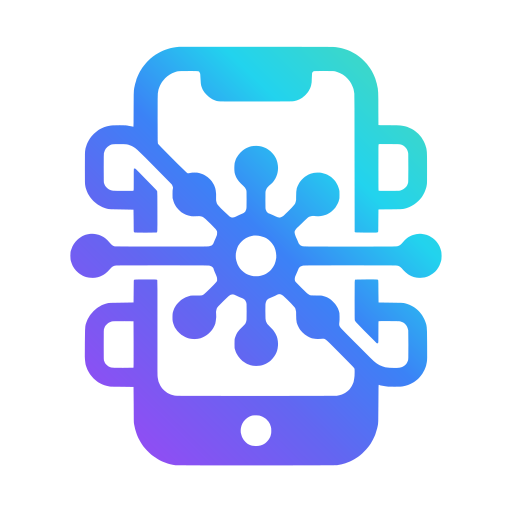

<p align="center">
  
</p>

# Phone MCP

> Turn your Android phone into a secure MCP server for AI agents — sensors, camera, audio, location, BLE, NFC, and UI automation over LAN HTTPS.

**Who is this for?** AI-agent developers who want a real phone as eyes, ears, hands, and sensors — from OpenCode, Claude, Codex, Cursor, Gemini CLI, Cline, VS Code, or Windsurf.

**How it works in 30 seconds:** Start the app → tap Start → point your agent at `https://<phone-lan-ip>:8080/mcp` with the pairing token → call tools like `vibrate`, `camera_capture`, or `sensors_read`.

## Contents

- [Quick Start (5 minutes)](#quick-start-5-minutes)
- [What it does](#what-it-does)
- [Key Features](#key-features)
- [Tech Stack](#tech-stack)
- [Prerequisites](#prerequisites)
- [Getting Started](#getting-started)
- [Architecture](#architecture)
- [Configuration](#configuration)
- [Documentation](#documentation)
- [Testing & Verification](#testing--verification)
- [Troubleshooting](#troubleshooting)
- [Contributing](#contributing)
- [License](#license)

> 🔒 **Security first:** TLS-only (self-signed cert, TOFU SHA-256 fingerprint shown in dashboard/QR/startup log) + `Authorization: Bearer <token>` on `/mcp`, `/media/*`, `/info` (`/healthz` is open). Run only on networks you trust. See ADR-0009/0010.

## Quick Start (5 minutes)

You need: an Android device (API 29+), a computer on the **same Wi-Fi**, and the pairing token from the app dashboard.

```bash
# 1. Install + start (on phone)
# Install release/phone-mcp-v0.1.0-debug.apk, open "Phone MCP", grant Camera/Mic/Location/BLE/Notifications,
# enable the toggles you need, tap Start. Note the IP:port shown.

# 2. Verify (from your computer, same LAN)
export TOKEN=<paste-from-dashboard-pairing-card>
./scripts/verify-mcp.sh 192.168.1.50:8080

# 3. Call your first tool
curl -sk -X POST https://192.168.1.50:8080/mcp \
 -H 'Content-Type: application/json' -H 'Accept: application/json, text/event-stream' \
 -H 'MCP-Protocol-Version: 2025-06-18' -H "Authorization: Bearer $TOKEN" \
 -d '{"jsonrpc":"2.0","id":3,"method":"tools/call","params":{"name":"vibrate","arguments":{}}}'

# 4. Connect your agent harness (one install covers 9 harnesses)
pip install ./client
phone-mcp pair --qr '<dashboard-qr-json>'
phone-mcp smoke                             # expect 4x PASS
phone-mcp configure --harness all --out ./generated-harness
```

No-Python hosts: `npm install -g ./client/node` (same CLI, same 9 harnesses).
Details: [Getting Started](#getting-started) · `docs/client.md` · `docs/harness.md`.

## What it does

| Capability | Example tools | Where blobs go |
|---|---|---|
| 👁️ **Sense** — snapshot sensors, location, battery, BLE, NFC, clipboard | `sensors_read`, `location_read`, `battery_read`, `ble_scan`, `nfc_read`, `clipboard_get/set`, `device_info` | JSON in `result.content` |
| 🎥 **Capture** — photos, video, audio as downloadable files | `camera_capture`, `camera_video`, `audio_record` | `GET /media/{id}` (15-min TTL, 100 MB cap, Range support) |
| 🔊 **Act** — speak, buzz, flash, drive UI | `speaker_say`, `vibrate`, `torch`, `ui_screenshot/dump/click/swipe/type/key` | Immediate effect + status |
| 📡 **Stream** — live sensor/GPS and audio batches over SSE | `sensors_stream`, `audio_stream` (one stream at a time each) | `text/event-stream` |
| 🛜 **Inspect network** (opt-in VPN, metadata only — HTTPS never decrypted) | `net_status/connections/usage/capture_start/capture_stop/export_pcap/export_har/firewall_get/firewall_set/blocklist_check/geo_lookup/tls_info` + `net_stream` | JSON + pcap/HAR via `/media` |

Agents connect via `POST https://<phone-lan-ip>:8080/mcp` (JSON-RPC 2.0, Streamable HTTP, protocol `2025-06-18`, min `2025-03-26`).

## Key Features

- **Secure by default** — bearer token (EncryptedSharedPreferences, QR pairing, one-tap rotation); TLS-only listener with fail-closed TOFU fingerprint; LAN-only bind + Origin check.
- **Standard MCP endpoint** — `initialize`, `tools/list` (41 tools), `tools/call`, `ping`; tool failures return `isError:true`, protocol errors only `-32601/-32602/-32603` (+ `-32001` auth, `-32600` transport).
- **Guardrailed** — kill-switches default OFF for `audio_*`, `camera_*`, `net_*`, `ui_*`, and `ble_write`; runtime permission explainers in the dashboard.
- **Modern dashboard** — Compose Material3 + Material You dynamic color, System/Light/Dark mode, server hero card, pairing QR, live tool-call log, QS-tile/widget pins. Secure window (`FLAG_SECURE`) so token/QR never leak into mirrors or recents.
- **Clean layers** — pure-Kotlin `mcp/` (no `android.*`, JVM unit-testable) → `domain/` contracts → `data/` framework → `service/` Ktor foreground service → `presentation/` Compose UI.
- **Harness-ready** — unified `phone-mcp` client (Python + zero-dep Node twins, parity-tested) and stdio bridge fallback for OpenCode, Claude Code/Desktop, Codex, VS Code, Cursor, Gemini CLI, Cline, and Windsurf.

## Tech Stack

| Area | Choices |
|---|---|
| Language / Build | Kotlin 2.2, Java 17, Gradle 8, AGP 8.6 (`compileSdk 35`, `minSdk 29`, `targetSdk 35`) |
| App | Compose Material3, Hilt, Coroutines/Flow |
| Server | Ktor Netty 3.6.0 + `content-negotiation` + `kotlinx-json`, kotlinx.serialization 1.8.1 (Netty chosen because CIO has no server-SSL — ADR-0011) |
| Device | CameraX 1.3.4, Play Services Location 21.3.0, SensorManager, MediaRecorder, BluetoothLeScanner, NFC reader mode |
| Test / CI | JUnit4 + MockK, `scripts/verify-mcp.sh` (curl conformance), `scripts/fuzz-mcp.py`; GitHub Actions (`testDebugUnitTest` + `lintDebug` + `harness`; hardware matrix stays manual — `docs/ci.md`) |

## Prerequisites

| Requirement | Details |
|---|---|
| Machine | Android Studio (Giraffe+), JDK 17, Android SDK 35 |
| Device | Android phone/emulator, API 29+ |
| Network | Phone + agent host on the same Wi-Fi; `adb` for USB fallback (`adb reverse tcp:8080 tcp:8080`) |

Full local-env reference: `docs/environments.md` + `.env.example`.

## Getting Started

### 1. Clone + environment check

```bash
git clone <your-repo-url> phone-mcp
cd phone-mcp
cp .env.example .env   # never commit .env / local.properties / keystores
./scripts/setup.sh     # checks java, SDK, adb
# Open the folder in Android Studio, let it provision Gradle wrapper + SDK 35.
```

### 2. Run on device

```bash
adb install -r release/phone-mcp-v0.1.0-debug.apk   # prebuilt + signed (44 MB, v0.1.0); or rebuild below
# Launch "Phone MCP", grant runtime perms (Camera, Mic, Location, BLE, Notifications),
# enable mic/camera toggles, tap Start. Note IP:port shown.
```

Rebuild from source (same output at `app/build/outputs/apk/debug/app-debug.apk`):

```bash
./gradlew :app:assembleDebug
```

Headless start/stop (needs QS tile added once):

```bash
adb shell cmd statusbar click-tile com.phonemcp.server/.service.McpServerTile
```

### 3. Verify MCP (from LAN host)

```bash
export TOKEN=<paste-from-dashboard-pairing-card>
./scripts/verify-mcp.sh 192.168.1.50:8080
# Or MCP Inspector → Streamable HTTP → https://192.168.1.50:8080/mcp
# (+ Authorization: Bearer $TOKEN; accept the self-signed cert after verifying its fingerprint)
```

### 4. Call a tool

```bash
curl -sk -X POST https://192.168.1.50:8080/mcp \
 -H 'Content-Type: application/json' -H 'Accept: application/json, text/event-stream' \
 -H 'MCP-Protocol-Version: 2025-06-18' -H "Authorization: Bearer $TOKEN" \
 -d '{"jsonrpc":"2.0","id":3,"method":"tools/call","params":{"name":"vibrate","arguments":{}}}'
```

Success → `result {content[], isError:false}`. Tool-logic failure → `result {content[], isError:true}` naming the kill-switch/permission.

### 5. Connect your agent harness

The phone cert is self-signed (TOFU), so harnesses connect through the unified `phone-mcp` client (stdio bridge owns Bearer auth + fingerprint pinning):

```bash
pip install ./client
phone-mcp pair --qr '<dashboard-qr-json>'   # saves ~/.config/phone-mcp/config.json (0600)
phone-mcp smoke                             # expect 4x PASS
phone-mcp configure --harness all --out ./generated-harness
phone-mcp configure --harness opencode --install
```

- No-Python hosts: `npm install -g ./client/node` (same CLI, 9 harnesses; tests: `node --test client/node/test/test-*.mjs`).
- No-install fallback (same protocol, single file): `bridges/phone-mcp-bridge.mjs` (Node 18+) or `bridges/phone-mcp-bridge.py` (stdlib Python) + `./scripts/configure-harness.sh --from-qr '<qr-json>' --harness all` + `python3 scripts/phone-mcp-smoke.py …`.

## Architecture

```text
Agent → POST /mcp (McpRouter) → Gatekeeper → ToolProvider [data/*] → cacheDir/mcp
      → GET /media/{id} (FileMediaStore) → dashboard log

Layers: presentation/ (Compose) · mcp/ (pure Kotlin JSON-RPC) · domain/ (ToolProvider, Gatekeeper, MediaStore)
        · data/ (framework) · service/ (Ktor FGS) · di/ (Hilt)
```

Request lifecycle: `POST /mcp` → Origin check → version negotiate → `initialize` → `tools/call {name, args}` → permission + kill-switch gate → provider suspend fun (5s sensors / 30s capture) → `result {content[], isError}` or JSON-RPC error (`-32601/-32602/-32603`).

See `docs/adr/` (ADR-0001…0030) for transport, TLS engine, protocol, media, auth, dashboard safety, VPN inspection, UI redesign, bridge, CA export, client, and agent-skills decisions.

## Configuration

Local-only. Full reference: `docs/environments.md` + `.env.example`.

| Variable | Description | Default |
|---|---|---|
| `PHONE_MCP_PORT` (`ServerConfig.port`) | Ktor listen port | `8080` |
| `PHONE_MCP_HOST` (`ServerConfig.host`) | Bind (keep `0.0.0.0` LAN) | `0.0.0.0` |
| `PHONE_MCP_TOKEN` / `TOKEN` | Bearer token (dashboard pairing card) | — (required) |
| Media TTL / cap (`FileMediaStore`) | Sidecar eviction | `15 min / 100 MB` |
| Kill-switches (`Gatekeeper`) | `audio_*`, `camera_*`, `net_*`, `ui_*` default OFF | OFF |

## Documentation

| I want to… | Start here |
|---|---|
| 📞 Call the API (41 tools, transports, SSE, errors) | `docs/api.md` |
| 🔌 Connect my harness (pair/smoke/configure, 9-harness matrix) | `docs/client.md`, `docs/harness.md`, `config/harness-examples/` |
| 💻 Use the client source (Python 79 tests + Node 71 tests) | `client/` + `client/node/` |
| 🌉 Use the no-install bridge (Bearer + TOFU pin, parity-tested) | `bridges/phone-mcp-bridge.mjs`, `bridges/phone-mcp-bridge.py` |
| 🧪 Run conformance / fuzz / proofs | `scripts/verify-mcp.sh`, `scripts/fuzz-mcp.py` (12/12), `scripts/phone-mcp-smoke.py`, `scripts/collect-proofs.sh`, `scripts/configure-harness.sh`, `scripts/export-ca.sh` |
| ⚙️ Set up local env + signing | `docs/environments.md`, `.env.example` |
| 🎨 Match the UI / brand | `DESIGN.md`, `docs/branding.md`, `assets/logo/`, `docs/assets/screenshots/` |
| 🏛️ Understand decisions | `docs/adr/` (ADR-0001…0030) |
| 🤖 Work as an agent in this repo | `AGENTS.md` |
| 🧠 Teach an agent the 41 tools (6 skills, 41/41 coverage) | `.agents/skills/phone-mcp*/` (router + sense/capture/wireless/ui/net), `scripts/verify-skills.py`, `docs/adr/0030-agent-skills.md` — `phone-mcp configure` stages + installs them automatically (ADR-0031) |
| 📱 Ship / test on devices | `docs/device-matrix.md`, `docs/ci.md`, `docs/play-release.md`, `docs/testing.md`, `docs/privacy-policy.md` |

## Testing & Verification

| Task | Command |
|---|---|
| JVM unit tests | `./gradlew testDebugUnitTest` |
| Lint (NewApi blocking) | `./gradlew lintDebug` |
| MCP conformance | `TOKEN=<token> ./scripts/verify-mcp.sh <ip>:8080` |
| Host fuzz | `python3 scripts/fuzz-mcp.py` |
| Harness smoke | `phone-mcp smoke --timeout 20` |
| Bridge unit tests | `python3 -m unittest discover -s bridges -p "test_*.py"` |
| Client tests (Python) | `python3 -m unittest discover -s client/tests` |
| Client tests (Node) | `node --test client/node/test/test-*.mjs` |
| Agent skills gate (6 skills, 41/41) | `python3 scripts/verify-skills.py` |
| Agent skills eval (static + live battery) | `python3 scripts/eval-skills.py` |

## Troubleshooting

| Symptom | Fix |
|---|---|
| Sound comes from computer, not phone | Screen-mirror with audio forwarding (e.g. `scrcpy`) captured it — check `speaker_say`'s `output` for `remote_submix(mirrored)`. Re-run mirror with `--no-audio` or stop it. |
| Black screen in scrcpy / mirror | Dashboard uses secure window (`FLAG_SECURE`) so token/QR never leak. Settings → Appearance → **Secure screen OFF** to drive over mirror (re-enable afterwards). |
| Empty `tools/list` | Service not started or providers not bound — check dashboard log + `GET /healthz`. |
| Camera/mic `SecurityException` | Grant runtime perm while app is foreground; keep FGS notification visible (API 34 while-in-use). |
| Clipboard null on API 29+ | Read only works while app is focused; `clipboard_set` works headless. |
| Port in use | Change `ServerConfig.port` + rebuild, or clear `adb reverse --remove-all`. |

## Contributing

See `AGENTS.md` for layer rules, commands, and conventions (pure-Kotlin `mcp/`, `ToolProvider` + Hilt `@IntoSet`, `isError:true` for domain failures). Keep `README.md` + `docs/api.md` in sync with `McpRouter`/`*Provider`; `scripts/verify-mcp.sh` is the conformance gate.

## License

TBD (add LICENSE before distribution).
